# Warehouse schema (ERD)

Every table and view the DDL creates: 55 schemas, 173 tables, 150 views, 37 partitions, 250 foreign keys.
The diagrams below were generated by applying `sql/bootstrap/warehouse_manifest.json` to an empty Postgres 16 + PostGIS and reading the catalog back
with [`catalog.sql`](catalog.sql), so the keys are the ones Postgres enforces. Solid lines are foreign keys; `read by` lines are views reading a relation.
Each entity lists its primary key, foreign keys, and its geography, time, metric and value columns, not every column.

Interactive version with every column: [Warehouse Schema Atlas](https://claude.ai/artifact/XYhRUj6iMa1djxw3eY3GG6). Sources: [data-sources.md](data-sources.md).

Entity names are `schema__table` because Mermaid does not allow dots in entity names.

## How data moves

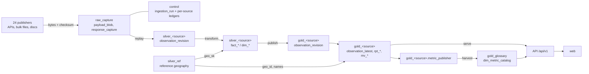

## Capture backbone

Every provider response is stored once as bytes (payload_blob) and described once (response_capture). Every pipeline run is one ingestion_run. Silver revision tables point back at both, so any served number can be traced to the exact response it came from.

11 tables, 2 views.

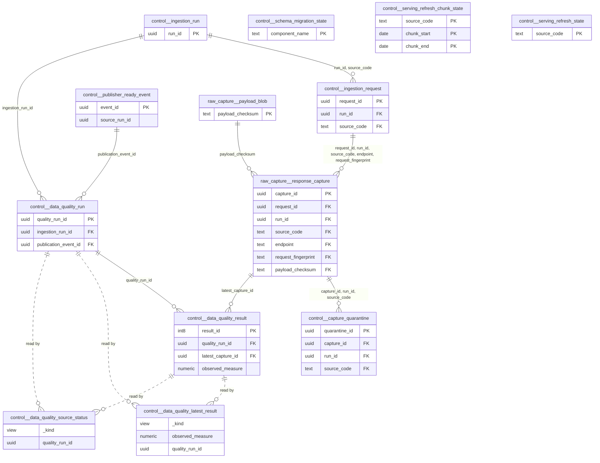

## Reference geography

silver_ref holds one row per place (dim_geo_entity) with yearly attribute and boundary versions, and a bridge of relationships between places (contains, intersects, adjacent). Facts join to it by geo_sk; serving views and map tiles read it through gold_glossary and gold.

12 tables, 10 views.

```mermaid
erDiagram
    gold__dim_geo_latest {
        view _kind
        text geo_id
    }
    gold__dim_geography {
        view _kind
        text geo_id
    }
    gold__tile_boundary {
        view _kind
        text geo_id
    }
    gold__tile_layer_vintage {
        view _kind
    }
    gold__tile_tract {
        view _kind
        text geo_id
    }
    gold_glossary__dim_geo_latest {
        text geo_id PK
    }
    gold_glossary__dim_geography {
        view _kind
        text geo_id
    }
    gold_glossary__geo_boundary {
        view _kind
        text geo_id
    }
    gold_glossary__geo_relationship {
        view _kind
        text geo_id
        text related_geo_id
    }
    gold_glossary__geo_search {
        text geo_id PK
        text county_geo_id
        int population_year
        text population_metric_code
    }
    gold_glossary__tile_boundary_version {
        text geo_id PK
        int boundary_vintage PK
    }
    raw_capture__response_capture {
        uuid capture_id PK
        uuid request_id FK
        uuid run_id FK
        text source_code FK
        text endpoint FK
        text request_fingerprint FK
        text payload_checksum FK
    }
    silver_ref__bridge_geo_relationship_version {
        int8 relationship_sk PK
        int8 parent_geo_sk FK
        int8 related_geo_sk FK
        uuid source_snapshot_id FK
    }
    silver_ref__dim_geo {
        view _kind
        int8 geo_sk
        text geo_id
        int source_year
        int first_seen_year
        int last_seen_year
    }
    silver_ref__dim_geo_current {
        view _kind
        int8 geo_sk
        text geo_id
        int source_year
        int first_seen_year
        int last_seen_year
    }
    silver_ref__dim_geo_entity {
        int8 geo_sk PK
        text geo_type FK
        text geo_id
    }
    silver_ref__dim_geo_entity_version {
        int8 geo_version_sk PK
        int8 geo_sk FK
        uuid source_snapshot_id FK
    }
    silver_ref__dim_geo_geometry_version {
        int8 geo_geometry_sk PK
        int8 geo_sk FK
        uuid source_snapshot_id FK
    }
    silver_ref__dim_geo_type {
        text geo_type PK
    }
    silver_ref__dim_time {
        int time_sk PK
        int year
        int week_of_year
    }
    silver_ref__geography_resolution {
        int8 resolution_sk PK
        int8 geo_sk FK
        uuid evidence_capture_id FK
    }
    silver_ref__tract_decade_crosswalk {
        int earlier_vintage PK
        int8 earlier_geo_sk PK
        int8 later_geo_sk PK
        uuid source_snapshot_id FK
    }
    silver_ref__dim_geo_type ||--o{ silver_ref__dim_geo_entity : "geo_type"
    silver_ref__dim_geo_entity ||--o{ silver_ref__dim_geo_entity_version : "geo_sk"
    raw_capture__response_capture ||--o{ silver_ref__dim_geo_entity_version : "source_snapshot_id"
    silver_ref__dim_geo_entity ||--o{ silver_ref__dim_geo_geometry_version : "geo_sk"
    raw_capture__response_capture ||--o{ silver_ref__dim_geo_geometry_version : "source_snapshot_id"
    silver_ref__dim_geo_entity ||--o{ silver_ref__bridge_geo_relationship_version : "parent_geo_sk"
    raw_capture__response_capture ||--o{ silver_ref__bridge_geo_relationship_version : "source_snapshot_id"
    silver_ref__dim_geo_entity ||--o{ silver_ref__geography_resolution : "geo_sk"
    raw_capture__response_capture ||--o{ silver_ref__geography_resolution : "evidence_capture_id"
    silver_ref__dim_geo_entity ||--o{ silver_ref__tract_decade_crosswalk : "earlier_geo_sk"
    raw_capture__response_capture ||--o{ silver_ref__tract_decade_crosswalk : "source_snapshot_id"
    silver_ref__dim_geo_entity ||..o{ silver_ref__dim_geo_current : "read by"
    silver_ref__dim_geo_entity_version ||..o{ silver_ref__dim_geo_current : "read by"
    silver_ref__dim_geo_geometry_version ||..o{ silver_ref__dim_geo_current : "read by"
    silver_ref__dim_geo_current ||..o{ silver_ref__dim_geo : "read by"
    gold_glossary__dim_geo_latest ||..o{ gold_glossary__geo_boundary : "read by"
    gold_glossary__dim_geo_latest ||..o{ gold_glossary__geo_relationship : "read by"
    silver_ref__bridge_geo_relationship_version ||..o{ gold_glossary__geo_relationship : "read by"
    silver_ref__dim_geo_entity ||..o{ gold_glossary__geo_relationship : "read by"
    gold_glossary__dim_geo_latest ||..o{ gold_glossary__dim_geography : "read by"
    gold_glossary__dim_geo_latest ||..o{ gold__dim_geo_latest : "read by"
    gold_glossary__dim_geography ||..o{ gold__dim_geography : "read by"
    gold_glossary__dim_geo_latest ||..o{ gold__tile_boundary : "read by"
    gold_glossary__dim_geo_latest ||..o{ gold__tile_tract : "read by"
    gold_glossary__tile_boundary_version ||..o{ gold__tile_layer_vintage : "read by"
```

## Census ACS and decennial

ACS and the 2000/1990 censuses share one chain. Variables and tables come from raw_census; responses are replayed into silver_census.observation_revision, transformed into fact_demographics, then served from gold_census.rpt_acs_observations (one partition per year, 2000-2035 plus a default) and mv_acs_latest (newest period only).

12 tables, 6 views.

```mermaid
erDiagram
    control__acs_ingestion_slices {
        int8 id PK
        int year
    }
    gold_census__acs_tract_comparable {
        view _kind
        text geo_id
        date observation_date
        text dataset_code
        int vintage_year
        text metric_code
        numeric comparable_value
    }
    gold_census__dim_acs_table {
        int8 acs_table_sk PK
        text dataset_code
        int vintage_year
    }
    gold_census__dim_acs_variable {
        int8 acs_variable_sk PK
        int8 acs_table_sk FK
        text dataset_code
        int vintage_year
    }
    gold_census__fact_acs_observation {
        view _kind
        varchar_255_ geo_id
        date observation_date
        varchar_50_ dataset_code
        int vintage_year
        numeric estimate_value
        text source_value
        uuid capture_id
    }
    gold_census__fact_observation {
        view _kind
        date observation_date
        text geo_id
        text metric_code
        numeric value
        text dataset_code
        int vintage_year
    }
    gold_census__metric_publisher {
        view _kind
        uuid source_run_id
    }
    gold_census__mv_acs_latest {
        date observation_date
        text geo_id
        numeric value
        text dataset_code
        int vintage_year
        numeric estimate_value
        text source_value
    }
    gold_census__rpt_acs_observations {
        date observation_date
        text geo_id
        numeric value
        text dataset_code
        int vintage_year
        numeric estimate_value
        text source_value
    }
    gold_census__v_metric_latest_by_geo {
        view _kind
        date observation_date
        text geo_id
        text metric_code
        numeric value
        text dataset_code
        int vintage_year
    }
    gold_census__v_metric_timeseries_by_geo {
        view _kind
        date observation_date
        text geo_id
        text metric_code
        numeric value
        text dataset_code
        int vintage_year
    }
    raw_capture__response_capture {
        shared_reference see_backbone_or_geography
    }
    raw_census__acs_datasets {
        text dataset PK
        int year PK
    }
    raw_census__acs_tables {
        text dataset PK
        text table_id PK
    }
    raw_census__acs_variables {
        text dataset PK
        int year PK
        text variable_name PK
    }
    silver_census__fact_demographics {
        int8 demographic_sk PK
        int time_sk FK
        int8 geo_sk FK
        uuid capture_id FK
        int estimate_year
        varchar_255_ geo_id
        numeric estimate_value
    }
    silver_census__observation_revision {
        uuid capture_id PK
        int source_row_index PK
        int source_column_index PK
        int year
        numeric value
    }
    silver_census__transform_checkpoint {
        text resume_key PK
        int year PK
        text slice_key PK
    }
    silver_census__transform_slice_state {
        int year PK
        text slice_key PK
    }
    silver_ref__dim_geo_entity {
        shared_reference see_backbone_or_geography
    }
    silver_ref__dim_time {
        shared_reference see_backbone_or_geography
    }
    raw_capture__response_capture ||--o{ silver_census__observation_revision : "capture_id"
    silver_ref__dim_time ||--o{ silver_census__fact_demographics : "time_sk"
    silver_ref__dim_geo_entity ||--o{ silver_census__fact_demographics : "geo_sk"
    raw_capture__response_capture ||--o{ silver_census__fact_demographics : "capture_id"
    gold_census__dim_acs_table ||--o{ gold_census__dim_acs_variable : "acs_table_sk"
    gold_census__dim_acs_variable ||..o{ gold_census__fact_acs_observation : "read by"
    silver_census__fact_demographics ||..o{ gold_census__fact_acs_observation : "read by"
    gold_census__rpt_acs_observations ||..o{ gold_census__acs_tract_comparable : "read by"
    silver_ref__dim_geo_entity ||..o{ gold_census__acs_tract_comparable : "read by"
    gold_census__dim_acs_table ||..o{ gold_census__metric_publisher : "read by"
    gold_census__dim_acs_variable ||..o{ gold_census__metric_publisher : "read by"
    gold_census__mv_acs_latest ||..o{ gold_census__metric_publisher : "read by"
    gold_census__rpt_acs_observations ||..o{ gold_census__fact_observation : "read by"
    gold_census__mv_acs_latest ||..o{ gold_census__v_metric_latest_by_geo : "read by"
    gold_census__fact_observation ||..o{ gold_census__v_metric_timeseries_by_geo : "read by"
```

## Population Estimates Program

U.S. Census Bureau: schemas silver_pep, gold_pep. Run ledger in silver_pep.release_load. Revisions keep every release; the latest view serves the newest; metric_publisher hands the metric list to the catalog.

6 tables, 7 views.

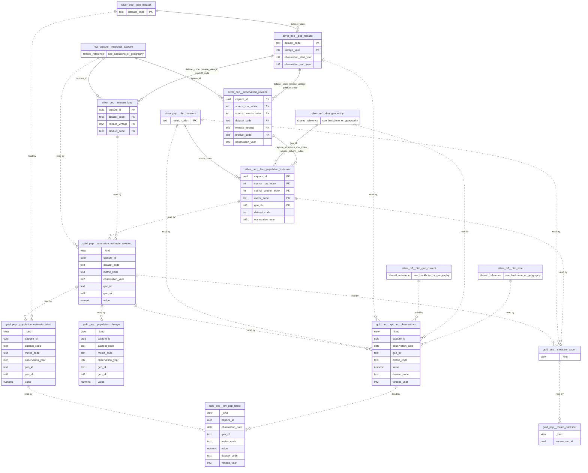

## BLS labor and prices (LAUS, CPS, CES, CPI, JOLTS, average prices)

Bureau of Labor Statistics: schemas raw_bls, silver_bls, gold_bls. Run ledger in control.bls_ingestion_slices. Revisions keep every release; the latest view serves the newest; metric_publisher hands the metric list to the catalog.

11 tables, 8 views.

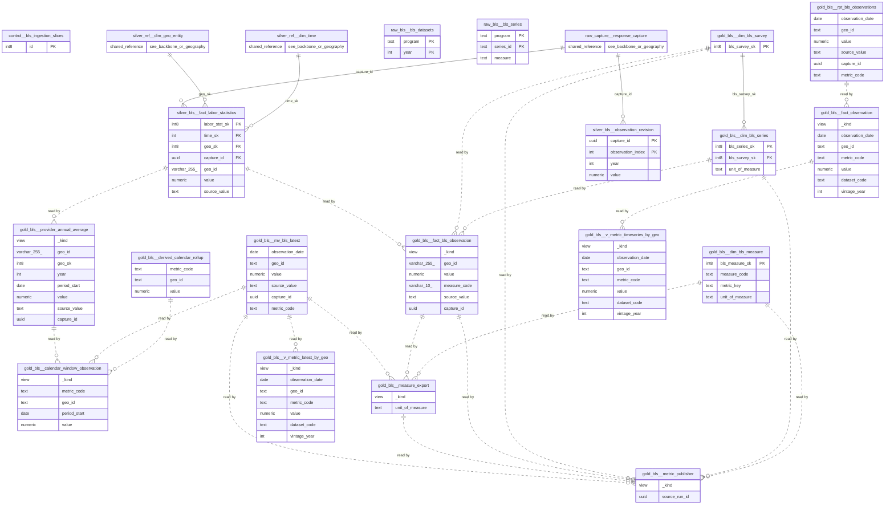

## FRED national indicators

Federal Reserve Bank of St. Louis: schemas raw_fred, silver_fred, gold_fred. Run ledger in control.fred_ingestion_slices. Revisions keep every release; the latest view serves the newest; metric_publisher hands the metric list to the catalog.

8 tables, 5 views.

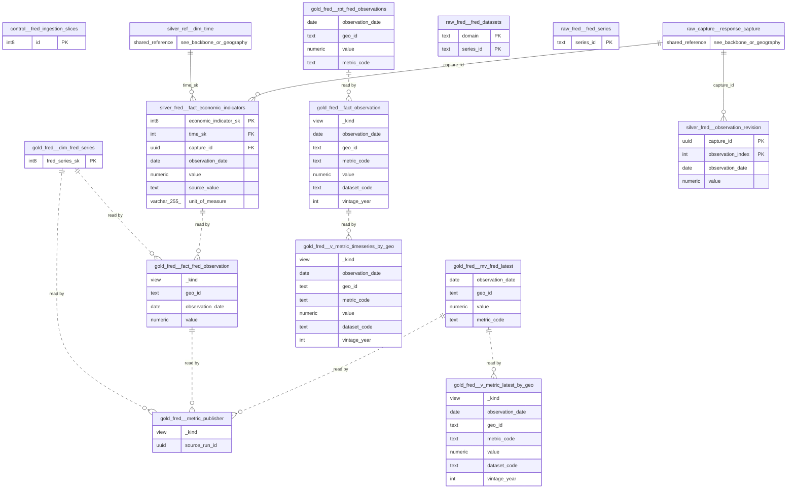

## Regional economic accounts

Bureau of Economic Analysis: schemas silver_bea, gold_bea. Run ledger in control.bea_table_capture. Revisions keep every release; the latest view serves the newest; metric_publisher hands the metric list to the catalog.

5 tables, 4 views.

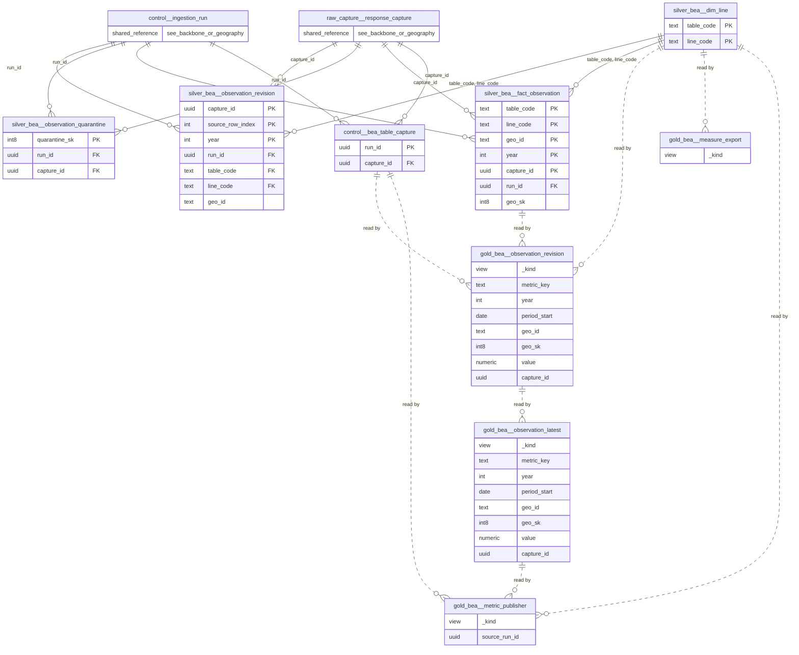

## Quarterly Census of Employment and Wages

Bureau of Labor Statistics: schemas silver_bls_qcew, gold_bls_qcew. Run ledger in control.bls_qcew_slice. Revisions keep every release; the latest view serves the newest; metric_publisher hands the metric list to the catalog.

6 tables, 4 views.

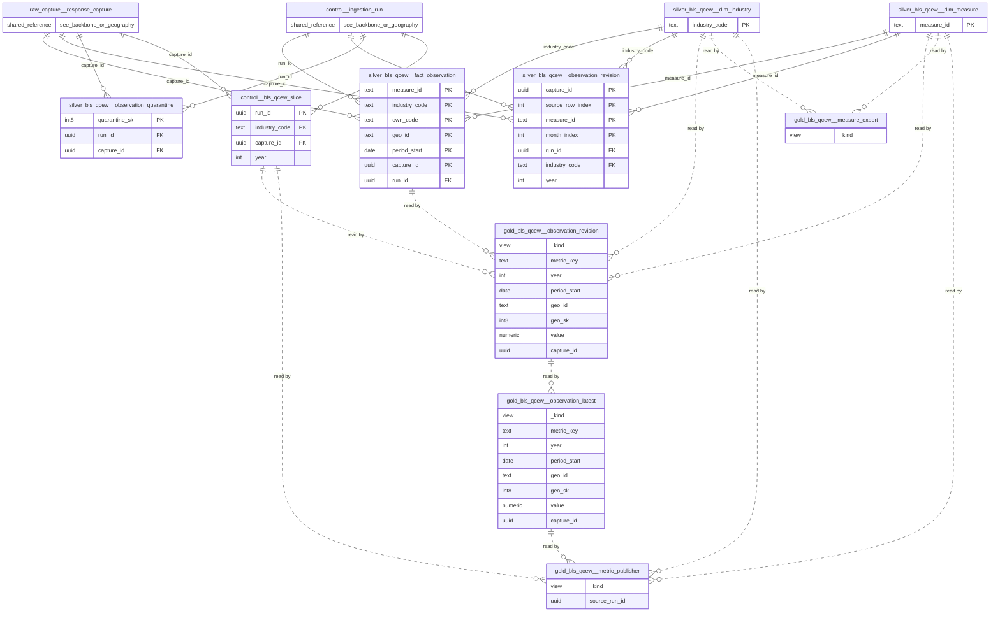

## County Business Patterns

U.S. Census Bureau: schemas silver_census_cbp, gold_census_cbp. Run ledger in control.census_cbp_file. Revisions keep every release; the latest view serves the newest; metric_publisher hands the metric list to the catalog.

4 tables, 6 views.

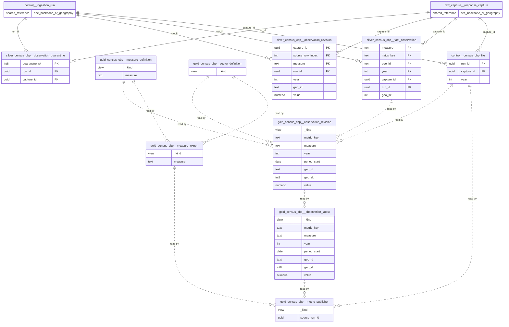

## SAIPE and SAHIE

U.S. Census Bureau: schemas silver_census_sae, gold_census_sae. Run ledger in control.census_sae_slice. Revisions keep every release; the latest view serves the newest; metric_publisher hands the metric list to the catalog.

5 tables, 4 views.

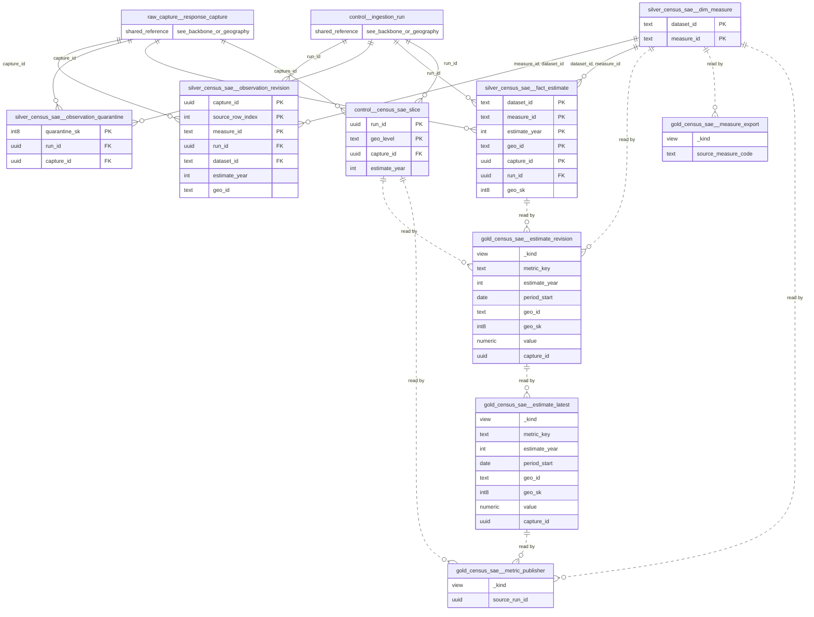

## LEHD Origin-Destination Employment Statistics

U.S. Census Bureau: schemas silver_census_lodes, gold_census_lodes. Run ledger in control.census_lodes_slice, control.census_lodes_file. Revisions keep every release; the latest view serves the newest; metric_publisher hands the metric list to the catalog.

5 tables, 5 views.

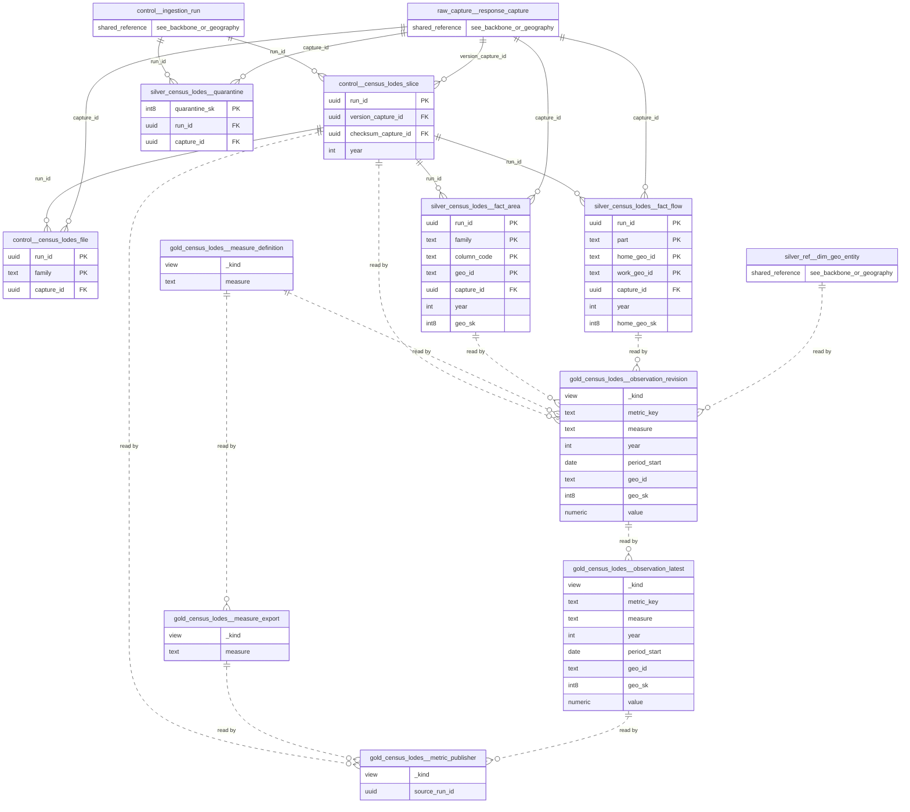

## SOI county-to-county migration

IRS Statistics of Income: schemas silver_irs_migration, gold_irs_migration. Run ledger in control.irs_migration_file. Revisions keep every release; the latest view serves the newest; metric_publisher hands the metric list to the catalog.

4 tables, 6 views.

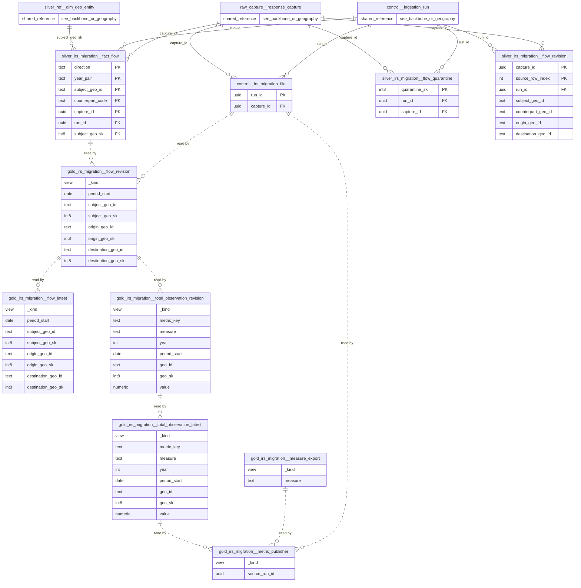

## Building Permits Survey

U.S. Census Bureau: schemas silver_census_bps, gold_census_bps. Run ledger in control.census_bps_slice. Revisions keep every release; the latest view serves the newest; metric_publisher hands the metric list to the catalog.

5 tables, 4 views.

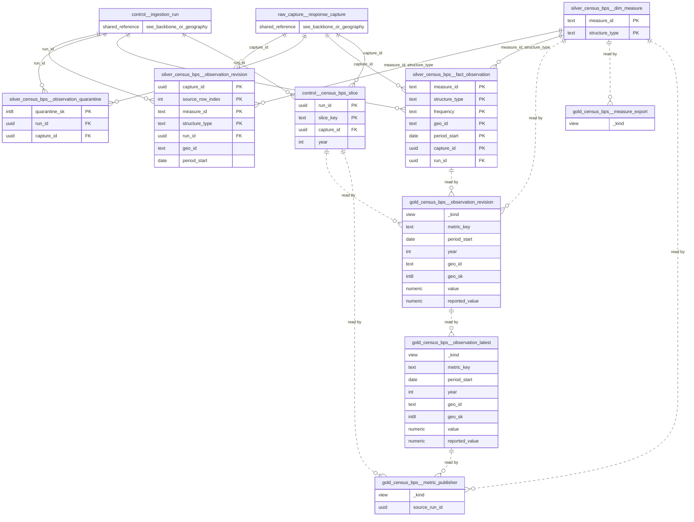

## House Price Index (annual, all transactions)

Federal Housing Finance Agency: schemas silver_fhfa_hpi, gold_fhfa_hpi. Run ledger in control.fhfa_hpi_file. Revisions keep every release; the latest view serves the newest; metric_publisher hands the metric list to the catalog.

4 tables, 5 views.

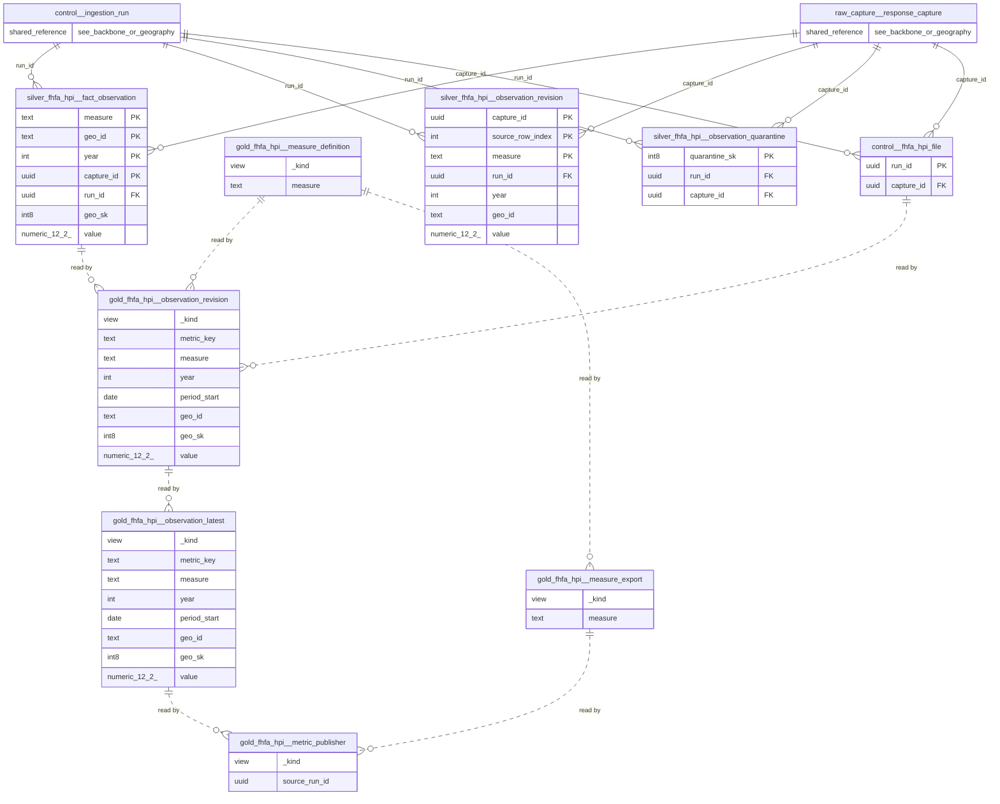

## Fair Market Rents and income limits

HUD: schemas silver_hud_fmr_il, gold_hud_fmr_il. Run ledger in control.hud_fmr_il_api_capture, control.hud_fmr_il_file. Revisions keep every release; the latest view serves the newest; metric_publisher hands the metric list to the catalog.

5 tables, 5 views.

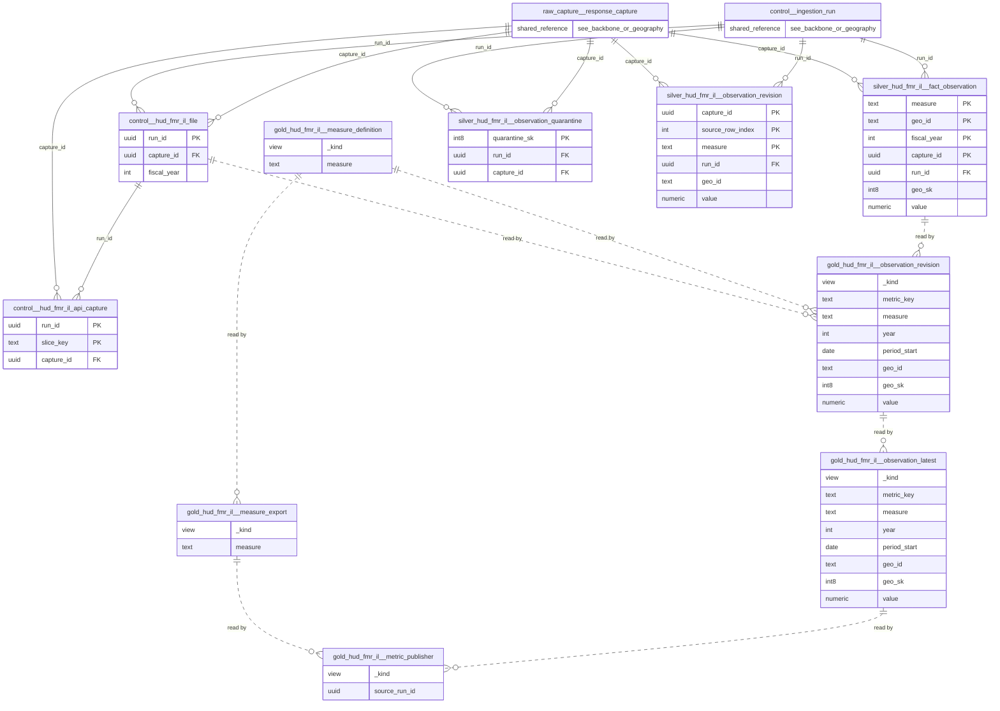

## Weekly retail gasoline prices

Energy Information Administration: schemas silver_eia, gold_eia. Run ledger in control.eia_read, control.eia_page. Revisions keep every release; the latest view serves the newest; metric_publisher hands the metric list to the catalog.

5 tables, 4 views.

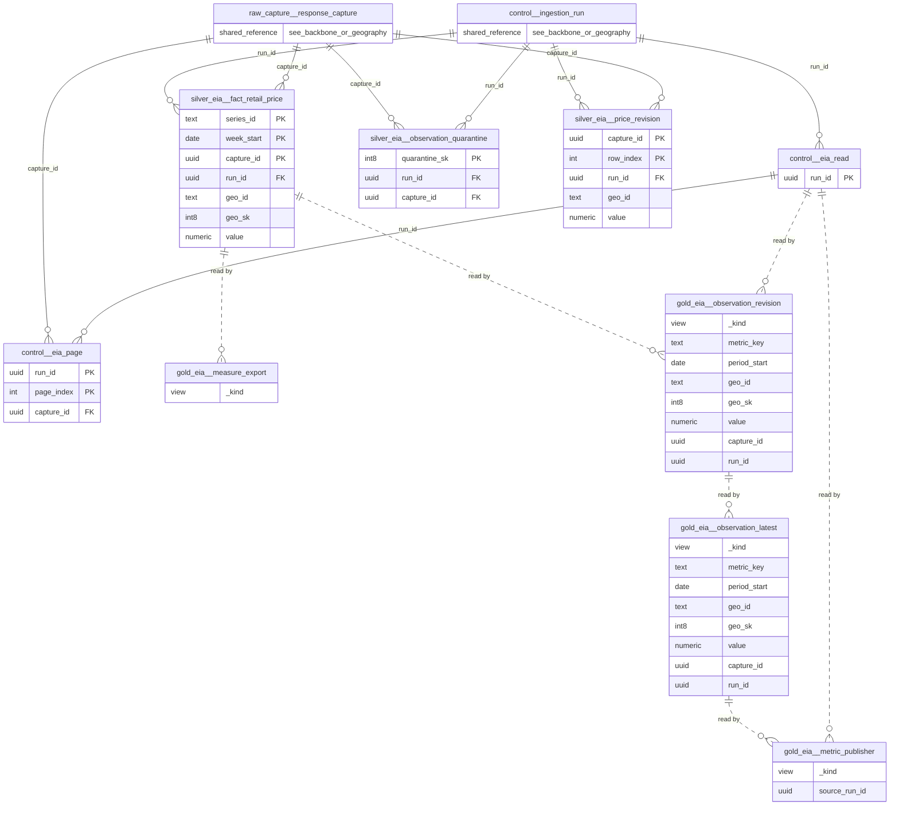

## Crime Data Explorer summarized offenses

FBI: schemas silver_fbi, gold_fbi. Run ledger in control.fbi_ucr_release. Revisions keep every release; the latest view serves the newest; metric_publisher hands the metric list to the catalog.

15 tables, 10 views.

```mermaid
erDiagram
    control__fbi_ucr_release {
        uuid run_id PK
        uuid release_capture_id FK
        text period_start
    }
    control__ingestion_run {
        shared_reference see_backbone_or_geography
    }
    gold_fbi__agency_geography {
        view _kind
        text geo_id
        int8 geo_sk
        uuid evidence_capture_id
        int8 agency_geo_sk
    }
    gold_fbi__agency_observation_area_filter {
        view _kind
        date period_start
        numeric value
        text filter_geo_id
        int8 filter_geo_sk
    }
    gold_fbi__calendar_window_observation {
        view _kind
        text metric_code
        text geo_id
        date period_start
        numeric value
    }
    gold_fbi__county_rollup {
        view _kind
        text geo_id
        int8 geo_sk
        date period_start
        numeric value
    }
    gold_fbi__crime_observation {
        view _kind
        date period_start
        text geo_id
        int8 geo_sk
        numeric value
        uuid capture_id
    }
    gold_fbi__derived_calendar_rollup {
        text metric_code
        text geo_id
        numeric value
    }
    gold_fbi__latest_county_rollup {
        view _kind
        text geo_id
        int8 geo_sk
        date period_start
        numeric value
    }
    gold_fbi__latest_release_observation {
        view _kind
        date period_start
        text geo_id
        int8 geo_sk
        numeric value
        uuid capture_id
    }
    gold_fbi__measure_export {
        view _kind
        text source_measure_code
    }
    gold_fbi__metric_publisher {
        view _kind
        uuid source_run_id
    }
    gold_fbi__reporting_coverage {
        view _kind
        date period_start
        text geo_id
        int8 geo_sk
        uuid capture_id
    }
    raw_capture__response_capture {
        shared_reference see_backbone_or_geography
    }
    silver_fbi__agency_geography_relationship {
        int8 relationship_sk PK
        text ori FK
        int8 geo_sk FK
        uuid evidence_capture_id FK
        text geo_id
    }
    silver_fbi__agency_revision {
        uuid capture_id PK
        int8 source_row_index PK
        uuid run_id FK
    }
    silver_fbi__dim_agency {
        text ori PK
        int8 geo_sk FK
    }
    silver_fbi__dim_agency_version {
        text ori PK
        text release_key PK
        uuid evidence_capture_id FK
    }
    silver_fbi__dim_offense_measure {
        text product_id PK
        text measure_id PK
    }
    silver_fbi__dim_state_code {
        text state_code PK
    }
    silver_fbi__dim_ucr_dataset_release {
        text product_id PK
        text release_key PK
        uuid release_capture_id FK
        uuid source_run_id FK
        text period_start
    }
    silver_fbi__fact_crime_observation {
        int8 observation_sk PK
        text product_id FK
        text release_key FK
        text measure_id FK
        text subject_type FK
        text subject_code FK
        text period FK
    }
    silver_fbi__fact_reporting_participation {
        int8 participation_sk PK
        text product_id FK
        text release_key FK
        int8 geo_sk FK
        uuid source_run_id FK
        uuid capture_id FK
        date period_start
    }
    silver_fbi__observation_revision {
        uuid capture_id PK
        int8 source_row_index PK
        uuid run_id FK
        date period_start
        numeric value
    }
    silver_fbi__participation_revision {
        uuid capture_id PK
        int8 source_row_index PK
        uuid run_id FK
        date period_start
    }
    silver_fbi__reviewed_place_crosswalk {
        text ori PK
        text place_geo_id PK
        date effective_start PK
    }
    silver_fbi__slice_quarantine {
        int8 quarantine_sk PK
        uuid run_id FK
    }
    silver_ref__dim_geo_current {
        shared_reference see_backbone_or_geography
    }
    silver_ref__dim_geo_entity {
        shared_reference see_backbone_or_geography
    }
    raw_capture__response_capture ||--o{ silver_fbi__agency_revision : "capture_id"
    control__ingestion_run ||--o{ silver_fbi__agency_revision : "run_id"
    raw_capture__response_capture ||--o{ silver_fbi__observation_revision : "capture_id"
    control__ingestion_run ||--o{ silver_fbi__observation_revision : "run_id"
    raw_capture__response_capture ||--o{ silver_fbi__participation_revision : "capture_id"
    control__ingestion_run ||--o{ silver_fbi__participation_revision : "run_id"
    silver_ref__dim_geo_entity ||--o{ silver_fbi__dim_agency : "geo_sk"
    control__ingestion_run ||--o{ silver_fbi__slice_quarantine : "run_id"
    raw_capture__response_capture ||--o{ silver_fbi__dim_ucr_dataset_release : "release_capture_id"
    control__ingestion_run ||--o{ silver_fbi__dim_ucr_dataset_release : "source_run_id"
    silver_fbi__dim_agency ||--o{ silver_fbi__dim_agency_version : "ori"
    raw_capture__response_capture ||--o{ silver_fbi__dim_agency_version : "evidence_capture_id"
    silver_ref__dim_geo_entity ||--o{ silver_fbi__agency_geography_relationship : "geo_sk"
    raw_capture__response_capture ||--o{ silver_fbi__agency_geography_relationship : "evidence_capture_id"
    silver_fbi__dim_agency ||--o{ silver_fbi__agency_geography_relationship : "ori"
    silver_ref__dim_geo_entity ||--o{ silver_fbi__fact_crime_observation : "geo_sk"
    control__ingestion_run ||--o{ silver_fbi__fact_crime_observation : "source_run_id"
    raw_capture__response_capture ||--o{ silver_fbi__fact_crime_observation : "capture_id"
    silver_fbi__dim_ucr_dataset_release ||--o{ silver_fbi__fact_crime_observation : "product_id, release_key"
    silver_fbi__dim_offense_measure ||--o{ silver_fbi__fact_crime_observation : "product_id, measure_id"
    silver_fbi__fact_reporting_participation ||--o{ silver_fbi__fact_crime_observation : "product_id, release_key, subject_type, subject_code, period"
    silver_ref__dim_geo_entity ||--o{ silver_fbi__fact_reporting_participation : "geo_sk"
    control__ingestion_run ||--o{ silver_fbi__fact_reporting_participation : "source_run_id"
    raw_capture__response_capture ||--o{ silver_fbi__fact_reporting_participation : "capture_id"
    silver_fbi__dim_ucr_dataset_release ||--o{ silver_fbi__fact_reporting_participation : "product_id, release_key"
    silver_fbi__dim_offense_measure ||..o{ gold_fbi__crime_observation : "read by"
    silver_fbi__dim_ucr_dataset_release ||..o{ gold_fbi__crime_observation : "read by"
    silver_fbi__fact_crime_observation ||..o{ gold_fbi__crime_observation : "read by"
    silver_fbi__fact_reporting_participation ||..o{ gold_fbi__crime_observation : "read by"
    silver_fbi__dim_ucr_dataset_release ||..o{ gold_fbi__reporting_coverage : "read by"
    silver_fbi__fact_reporting_participation ||..o{ gold_fbi__reporting_coverage : "read by"
    silver_fbi__agency_geography_relationship ||..o{ gold_fbi__agency_geography : "read by"
    silver_fbi__dim_agency ||..o{ gold_fbi__agency_geography : "read by"
    silver_fbi__dim_agency_version ||..o{ gold_fbi__agency_geography : "read by"
    silver_fbi__dim_ucr_dataset_release ||..o{ gold_fbi__agency_geography : "read by"
    gold_fbi__crime_observation ||..o{ gold_fbi__agency_observation_area_filter : "read by"
    silver_fbi__agency_geography_relationship ||..o{ gold_fbi__agency_observation_area_filter : "read by"
    gold_fbi__crime_observation ||..o{ gold_fbi__county_rollup : "read by"
    silver_fbi__agency_geography_relationship ||..o{ gold_fbi__county_rollup : "read by"
    silver_fbi__dim_offense_measure ||..o{ gold_fbi__county_rollup : "read by"
    silver_fbi__dim_ucr_dataset_release ||..o{ gold_fbi__county_rollup : "read by"
    silver_ref__dim_geo_current ||..o{ gold_fbi__county_rollup : "read by"
    gold_fbi__county_rollup ||..o{ gold_fbi__latest_county_rollup : "read by"
    silver_fbi__dim_ucr_dataset_release ||..o{ gold_fbi__latest_county_rollup : "read by"
    gold_fbi__crime_observation ||..o{ gold_fbi__latest_release_observation : "read by"
    silver_fbi__dim_ucr_dataset_release ||..o{ gold_fbi__latest_release_observation : "read by"
    silver_fbi__dim_offense_measure ||..o{ gold_fbi__measure_export : "read by"
    silver_fbi__dim_ucr_dataset_release ||..o{ gold_fbi__measure_export : "read by"
    gold_fbi__derived_calendar_rollup ||..o{ gold_fbi__calendar_window_observation : "read by"
    silver_fbi__dim_offense_measure ||..o{ gold_fbi__metric_publisher : "read by"
    silver_fbi__dim_ucr_dataset_release ||..o{ gold_fbi__metric_publisher : "read by"
    silver_fbi__fact_crime_observation ||..o{ gold_fbi__metric_publisher : "read by"
    control__ingestion_run ||--o{ control__fbi_ucr_release : "run_id"
    raw_capture__response_capture ||--o{ control__fbi_ucr_release : "release_capture_id"
```

## National Risk Index and disaster declarations

FEMA: schemas silver_fema_nri, gold_fema_nri. Run ledger in control.fema_nri_run, control.fema_nri_page. Revisions keep every release; the latest view serves the newest; metric_publisher hands the metric list to the catalog.

5 tables, 7 views.

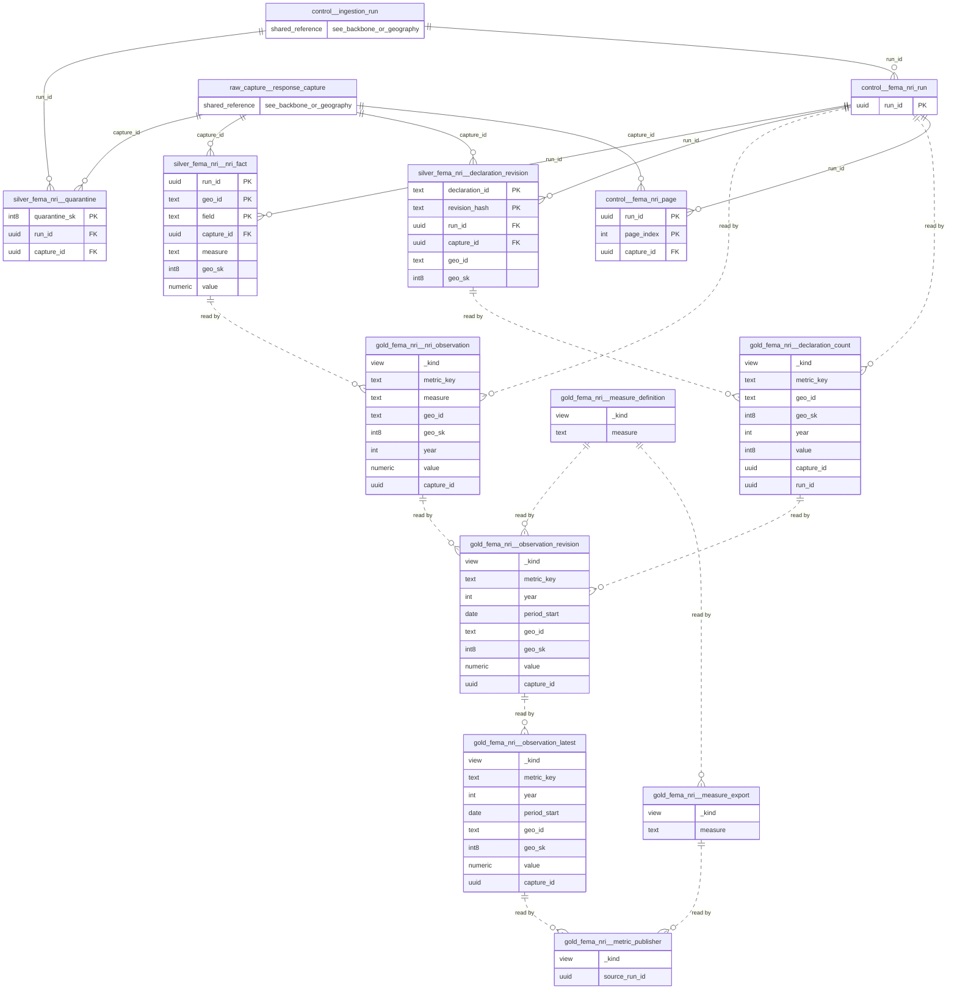

## Chronic Disease Indicators and PLACES

CDC: schemas silver_cdc, gold_cdc. Run ledger in control.cdc_dataset_release. Revisions keep every release; the latest view serves the newest; metric_publisher hands the metric list to the catalog.

7 tables, 4 views.

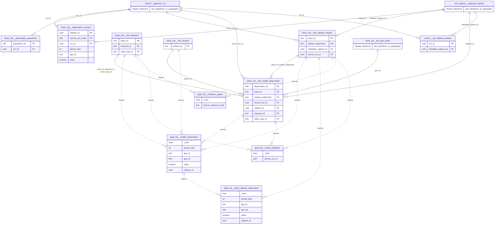

## AirData annual monitor concentrations

EPA: schemas silver_epa_aqs, gold_epa_aqs. Run ledger in control.epa_aqs_file. Revisions keep every release; the latest view serves the newest; metric_publisher hands the metric list to the catalog.

3 tables, 6 views.

```mermaid
erDiagram
    control__epa_aqs_file {
        uuid run_id PK
        uuid capture_id FK
        int year
    }
    control__ingestion_run {
        shared_reference see_backbone_or_geography
    }
    gold_epa_aqs__measure_definition {
        view _kind
        text measure
    }
    gold_epa_aqs__measure_export {
        view _kind
        text measure
    }
    gold_epa_aqs__metric_publisher {
        view _kind
        uuid source_run_id
    }
    gold_epa_aqs__monitor_observation {
        view _kind
        uuid run_id
        int year
        uuid capture_id
        text measure
        text geo_id
        int8 geo_sk
        numeric value
    }
    gold_epa_aqs__observation_latest {
        view _kind
        text metric_key
        int year
        date period_start
        text geo_id
        int8 geo_sk
        numeric value
        uuid capture_id
    }
    gold_epa_aqs__observation_revision {
        view _kind
        text metric_key
        int year
        date period_start
        text geo_id
        int8 geo_sk
        numeric value
        uuid capture_id
    }
    raw_capture__response_capture {
        shared_reference see_backbone_or_geography
    }
    silver_epa_aqs__monitor_fact {
        uuid run_id PK
        text monitor_id PK
        text sample_duration PK
        text pollutant_standard PK
        text event_type PK
        uuid capture_id FK
        int year
    }
    silver_epa_aqs__quarantine {
        int8 quarantine_sk PK
        uuid run_id FK
        uuid capture_id FK
    }
    control__epa_aqs_file ||--o{ silver_epa_aqs__monitor_fact : "run_id"
    raw_capture__response_capture ||--o{ silver_epa_aqs__monitor_fact : "capture_id"
    control__ingestion_run ||--o{ silver_epa_aqs__quarantine : "run_id"
    raw_capture__response_capture ||--o{ silver_epa_aqs__quarantine : "capture_id"
    control__epa_aqs_file ||..o{ gold_epa_aqs__monitor_observation : "read by"
    silver_epa_aqs__monitor_fact ||..o{ gold_epa_aqs__monitor_observation : "read by"
    gold_epa_aqs__measure_definition ||..o{ gold_epa_aqs__observation_revision : "read by"
    gold_epa_aqs__monitor_observation ||..o{ gold_epa_aqs__observation_revision : "read by"
    gold_epa_aqs__observation_revision ||..o{ gold_epa_aqs__observation_latest : "read by"
    gold_epa_aqs__measure_definition ||..o{ gold_epa_aqs__measure_export : "read by"
    gold_epa_aqs__measure_export ||..o{ gold_epa_aqs__metric_publisher : "read by"
    gold_epa_aqs__observation_latest ||..o{ gold_epa_aqs__metric_publisher : "read by"
    control__ingestion_run ||--o{ control__epa_aqs_file : "run_id"
    raw_capture__response_capture ||--o{ control__epa_aqs_file : "capture_id"
```

## U.S. Climate Normals 1991-2020

NOAA NCEI: schemas silver_noaa_normals, gold_noaa_normals. Run ledger in control.noaa_normals_file. Revisions keep every release; the latest view serves the newest; metric_publisher hands the metric list to the catalog.

4 tables, 6 views.

```mermaid
erDiagram
    control__ingestion_run {
        shared_reference see_backbone_or_geography
    }
    control__noaa_normals_file {
        uuid run_id PK
        uuid capture_id FK
    }
    gold_noaa_normals__measure_definition {
        view _kind
        text measure
    }
    gold_noaa_normals__measure_export {
        view _kind
        text measure
    }
    gold_noaa_normals__metric_publisher {
        view _kind
        uuid source_run_id
    }
    gold_noaa_normals__observation_latest {
        view _kind
        text metric_key
        int year
        date period_start
        text geo_id
        int8 geo_sk
        numeric value
        uuid capture_id
    }
    gold_noaa_normals__observation_revision {
        view _kind
        text metric_key
        int year
        date period_start
        text geo_id
        int8 geo_sk
        numeric value
        uuid capture_id
    }
    gold_noaa_normals__station_observation {
        view _kind
        uuid run_id
        text geo_id
        int8 geo_sk
        text measure
        numeric value
        uuid capture_id
    }
    raw_capture__response_capture {
        shared_reference see_backbone_or_geography
    }
    silver_noaa_normals__quarantine {
        int8 quarantine_sk PK
        uuid run_id FK
        uuid capture_id FK
    }
    silver_noaa_normals__station {
        uuid run_id PK
        text station_id PK
        uuid capture_id FK
        text geo_id
        int8 geo_sk
    }
    silver_noaa_normals__station_normal {
        uuid run_id PK
        text station_id PK
        text variable PK
        uuid capture_id FK
        text measure
        numeric value
    }
    control__ingestion_run ||--o{ silver_noaa_normals__quarantine : "run_id"
    raw_capture__response_capture ||--o{ silver_noaa_normals__quarantine : "capture_id"
    control__noaa_normals_file ||--o{ silver_noaa_normals__station : "run_id"
    raw_capture__response_capture ||--o{ silver_noaa_normals__station : "capture_id"
    raw_capture__response_capture ||--o{ silver_noaa_normals__station_normal : "capture_id"
    silver_noaa_normals__station ||--o{ silver_noaa_normals__station_normal : "run_id, station_id"
    control__noaa_normals_file ||..o{ gold_noaa_normals__station_observation : "read by"
    silver_noaa_normals__station ||..o{ gold_noaa_normals__station_observation : "read by"
    silver_noaa_normals__station_normal ||..o{ gold_noaa_normals__station_observation : "read by"
    gold_noaa_normals__measure_definition ||..o{ gold_noaa_normals__observation_revision : "read by"
    gold_noaa_normals__station_observation ||..o{ gold_noaa_normals__observation_revision : "read by"
    gold_noaa_normals__observation_revision ||..o{ gold_noaa_normals__observation_latest : "read by"
    gold_noaa_normals__measure_definition ||..o{ gold_noaa_normals__measure_export : "read by"
    gold_noaa_normals__measure_export ||..o{ gold_noaa_normals__metric_publisher : "read by"
    gold_noaa_normals__observation_latest ||..o{ gold_noaa_normals__metric_publisher : "read by"
    control__ingestion_run ||--o{ control__noaa_normals_file : "run_id"
    raw_capture__response_capture ||--o{ control__noaa_normals_file : "capture_id"
```

## Common Core of Data, public schools

NCES: schemas silver_nces_ccd, gold_nces_ccd. Run ledger in control.nces_ccd_file. Revisions keep every release; the latest view serves the newest; metric_publisher hands the metric list to the catalog.

5 tables, 7 views.

```mermaid
erDiagram
    control__ingestion_run {
        shared_reference see_backbone_or_geography
    }
    control__nces_ccd_file {
        uuid run_id PK
        uuid capture_id FK
        text school_year
    }
    gold_nces_ccd__measure_definition {
        view _kind
        text measure
    }
    gold_nces_ccd__measure_export {
        view _kind
        text measure
    }
    gold_nces_ccd__metric_publisher {
        view _kind
        uuid source_run_id
    }
    gold_nces_ccd__observation_latest {
        view _kind
        text metric_key
        int year
        text school_year
        date period_start
        text geo_id
        int8 geo_sk
        numeric value
    }
    gold_nces_ccd__observation_revision {
        view _kind
        text metric_key
        int year
        text school_year
        date period_start
        text geo_id
        int8 geo_sk
        numeric value
    }
    gold_nces_ccd__school_observation {
        view _kind
        uuid run_id
        text school_year
        uuid capture_id
        text measure
        numeric value
        text county_geo_id
        int8 county_geo_sk
    }
    gold_nces_ccd__school_placement {
        view _kind
        text school_year
        text county_geo_id
        int8 county_geo_sk
    }
    raw_capture__response_capture {
        shared_reference see_backbone_or_geography
    }
    silver_nces_ccd__quarantine {
        int8 quarantine_sk PK
        uuid run_id FK
        uuid capture_id FK
    }
    silver_nces_ccd__school_count {
        uuid run_id PK
        text ncessch PK
        text measure PK
        uuid capture_id FK
        numeric value
    }
    silver_nces_ccd__school_directory {
        uuid run_id PK
        text ncessch PK
        uuid capture_id FK
    }
    silver_nces_ccd__school_location {
        uuid run_id PK
        text ncessch PK
        uuid capture_id FK
        text geo_id
        int8 geo_sk
    }
    silver_ref__dim_geo_entity {
        shared_reference see_backbone_or_geography
    }
    control__nces_ccd_file ||--o{ silver_nces_ccd__school_directory : "run_id"
    raw_capture__response_capture ||--o{ silver_nces_ccd__school_directory : "capture_id"
    control__ingestion_run ||--o{ silver_nces_ccd__quarantine : "run_id"
    raw_capture__response_capture ||--o{ silver_nces_ccd__quarantine : "capture_id"
    control__nces_ccd_file ||--o{ silver_nces_ccd__school_count : "run_id"
    raw_capture__response_capture ||--o{ silver_nces_ccd__school_count : "capture_id"
    control__nces_ccd_file ||--o{ silver_nces_ccd__school_location : "run_id"
    raw_capture__response_capture ||--o{ silver_nces_ccd__school_location : "capture_id"
    control__nces_ccd_file ||..o{ gold_nces_ccd__school_placement : "read by"
    silver_nces_ccd__school_location ||..o{ gold_nces_ccd__school_placement : "read by"
    control__nces_ccd_file ||..o{ gold_nces_ccd__school_observation : "read by"
    gold_nces_ccd__school_placement ||..o{ gold_nces_ccd__school_observation : "read by"
    silver_nces_ccd__school_count ||..o{ gold_nces_ccd__school_observation : "read by"
    silver_nces_ccd__school_directory ||..o{ gold_nces_ccd__school_observation : "read by"
    gold_nces_ccd__measure_definition ||..o{ gold_nces_ccd__observation_revision : "read by"
    gold_nces_ccd__school_observation ||..o{ gold_nces_ccd__observation_revision : "read by"
    silver_ref__dim_geo_entity ||..o{ gold_nces_ccd__observation_revision : "read by"
    gold_nces_ccd__observation_revision ||..o{ gold_nces_ccd__observation_latest : "read by"
    gold_nces_ccd__measure_definition ||..o{ gold_nces_ccd__measure_export : "read by"
    gold_nces_ccd__measure_export ||..o{ gold_nces_ccd__metric_publisher : "read by"
    gold_nces_ccd__observation_latest ||..o{ gold_nces_ccd__metric_publisher : "read by"
    control__ingestion_run ||--o{ control__nces_ccd_file : "run_id"
    raw_capture__response_capture ||--o{ control__nces_ccd_file : "capture_id"
```

## National Broadband Map availability

FCC: schemas silver_fcc_bdc, gold_fcc_bdc. Run ledger in control.fcc_bdc_read, control.fcc_bdc_file. Revisions keep every release; the latest view serves the newest; metric_publisher hands the metric list to the catalog.

4 tables, 6 views.

```mermaid
erDiagram
    control__fcc_bdc_file {
        uuid run_id PK
        text slice_key PK
        uuid capture_id FK
    }
    control__fcc_bdc_read {
        uuid run_id PK
        uuid listing_capture_id FK
    }
    control__ingestion_run {
        shared_reference see_backbone_or_geography
    }
    gold_fcc_bdc__availability_observation {
        view _kind
        uuid run_id
        text geo_id
        uuid capture_id
        int8 geo_sk
    }
    gold_fcc_bdc__measure_definition {
        view _kind
        text measure
    }
    gold_fcc_bdc__measure_export {
        view _kind
        text measure
    }
    gold_fcc_bdc__metric_publisher {
        view _kind
        uuid source_run_id
    }
    gold_fcc_bdc__observation_latest {
        view _kind
        text metric_key
        int year
        date period_start
        text geo_id
        int8 geo_sk
        numeric value
        uuid capture_id
    }
    gold_fcc_bdc__observation_revision {
        view _kind
        text metric_key
        int year
        date period_start
        text geo_id
        int8 geo_sk
        numeric value
        uuid capture_id
    }
    raw_capture__response_capture {
        shared_reference see_backbone_or_geography
    }
    silver_fcc_bdc__availability_row {
        uuid run_id PK
        text geo_id PK
        text technology PK
        uuid capture_id FK
        int8 geo_sk
    }
    silver_fcc_bdc__quarantine {
        int8 quarantine_sk PK
        uuid run_id FK
        uuid capture_id FK
    }
    control__ingestion_run ||--o{ silver_fcc_bdc__quarantine : "run_id"
    raw_capture__response_capture ||--o{ silver_fcc_bdc__quarantine : "capture_id"
    control__fcc_bdc_read ||--o{ silver_fcc_bdc__availability_row : "run_id"
    raw_capture__response_capture ||--o{ silver_fcc_bdc__availability_row : "capture_id"
    control__fcc_bdc_file ||..o{ gold_fcc_bdc__availability_observation : "read by"
    control__fcc_bdc_read ||..o{ gold_fcc_bdc__availability_observation : "read by"
    silver_fcc_bdc__availability_row ||..o{ gold_fcc_bdc__availability_observation : "read by"
    gold_fcc_bdc__availability_observation ||..o{ gold_fcc_bdc__observation_revision : "read by"
    gold_fcc_bdc__measure_definition ||..o{ gold_fcc_bdc__observation_revision : "read by"
    gold_fcc_bdc__observation_revision ||..o{ gold_fcc_bdc__observation_latest : "read by"
    gold_fcc_bdc__measure_definition ||..o{ gold_fcc_bdc__measure_export : "read by"
    gold_fcc_bdc__measure_export ||..o{ gold_fcc_bdc__metric_publisher : "read by"
    gold_fcc_bdc__observation_latest ||..o{ gold_fcc_bdc__metric_publisher : "read by"
    control__ingestion_run ||--o{ control__fcc_bdc_read : "run_id"
    raw_capture__response_capture ||--o{ control__fcc_bdc_read : "listing_capture_id"
    control__fcc_bdc_read ||--o{ control__fcc_bdc_file : "run_id"
    raw_capture__response_capture ||--o{ control__fcc_bdc_file : "capture_id"
```

## Rural-urban codes, county typology, food atlas

USDA Economic Research Service: schemas silver_usda_ers, gold_usda_ers. Run ledger in control.usda_ers_file. Revisions keep every release; the latest view serves the newest; metric_publisher hands the metric list to the catalog.

4 tables, 5 views.

```mermaid
erDiagram
    control__ingestion_run {
        shared_reference see_backbone_or_geography
    }
    control__usda_ers_file {
        uuid run_id PK
        uuid capture_id FK
    }
    gold_usda_ers__measure_definition {
        view _kind
        text measure
    }
    gold_usda_ers__measure_export {
        view _kind
        text measure
    }
    gold_usda_ers__metric_publisher {
        view _kind
        uuid source_run_id
    }
    gold_usda_ers__observation_latest {
        view _kind
        text metric_key
        text measure
        int year
        date period_start
        text geo_id
        int8 geo_sk
        numeric value
    }
    gold_usda_ers__observation_revision {
        view _kind
        text metric_key
        text measure
        int year
        date period_start
        text geo_id
        int8 geo_sk
        numeric value
    }
    raw_capture__response_capture {
        shared_reference see_backbone_or_geography
    }
    silver_usda_ers__fact_observation {
        text attribute PK
        text geo_id PK
        uuid capture_id PK
        uuid run_id FK
        text measure
        int year
        int8 geo_sk
    }
    silver_usda_ers__observation_quarantine {
        int8 quarantine_sk PK
        uuid run_id FK
        uuid capture_id FK
    }
    silver_usda_ers__observation_revision {
        uuid capture_id PK
        int source_row_index PK
        uuid run_id FK
        text measure
        int year
        text geo_id
        numeric value
    }
    control__ingestion_run ||--o{ silver_usda_ers__observation_quarantine : "run_id"
    raw_capture__response_capture ||--o{ silver_usda_ers__observation_quarantine : "capture_id"
    raw_capture__response_capture ||--o{ silver_usda_ers__observation_revision : "capture_id"
    control__ingestion_run ||--o{ silver_usda_ers__observation_revision : "run_id"
    raw_capture__response_capture ||--o{ silver_usda_ers__fact_observation : "capture_id"
    control__ingestion_run ||--o{ silver_usda_ers__fact_observation : "run_id"
    control__usda_ers_file ||..o{ gold_usda_ers__observation_revision : "read by"
    gold_usda_ers__measure_definition ||..o{ gold_usda_ers__observation_revision : "read by"
    silver_usda_ers__fact_observation ||..o{ gold_usda_ers__observation_revision : "read by"
    gold_usda_ers__observation_revision ||..o{ gold_usda_ers__observation_latest : "read by"
    gold_usda_ers__measure_definition ||..o{ gold_usda_ers__measure_export : "read by"
    gold_usda_ers__measure_export ||..o{ gold_usda_ers__metric_publisher : "read by"
    gold_usda_ers__observation_latest ||..o{ gold_usda_ers__metric_publisher : "read by"
    control__ingestion_run ||--o{ control__usda_ers_file : "run_id"
    raw_capture__response_capture ||--o{ control__usda_ers_file : "capture_id"
```

## Quick Stats crops

USDA NASS: schemas silver_nass, gold_nass. Run ledger in control.usda_nass_release, control.usda_nass_slice. Revisions keep every release; the latest view serves the newest; metric_publisher hands the metric list to the catalog.

9 tables, 5 views.

```mermaid
erDiagram
    control__ingestion_run {
        shared_reference see_backbone_or_geography
    }
    control__usda_nass_release {
        uuid run_id PK
    }
    control__usda_nass_slice {
        uuid run_id PK
        text slice_key PK
        uuid count_capture_id FK
        uuid data_capture_id FK
        int year
    }
    gold_nass__crop_observation {
        view _kind
        text geo_id
        int8 geo_sk
        int year
        numeric value
        numeric cv_value
        uuid capture_id
    }
    gold_nass__crop_series {
        view _kind
        text geo_id
        int first_year
        int last_year
    }
    gold_nass__latest_release_observation {
        view _kind
        text geo_id
        int8 geo_sk
        int year
        numeric value
        numeric cv_value
        uuid capture_id
    }
    gold_nass__measure_export {
        view _kind
        text source_measure_code
    }
    gold_nass__metric_publisher {
        view _kind
        uuid source_run_id
    }
    raw_capture__response_capture {
        shared_reference see_backbone_or_geography
    }
    silver_nass__dim_commodity {
        text commodity_sk PK
    }
    silver_nass__dim_dataset_release {
        text product_id PK
        text release_watermark PK
        uuid source_run_id FK
    }
    silver_nass__dim_domain {
        text domain_sk PK
    }
    silver_nass__dim_statistic {
        text statistic_sk PK
    }
    silver_nass__fact_crop_observation {
        int8 observation_sk PK
        text product_id FK
        text release_watermark FK
        uuid source_run_id FK
        uuid capture_id FK
        text commodity_sk FK
        text statistic_sk FK
    }
    silver_nass__observation_quarantine {
        int8 quarantine_sk PK
        uuid run_id FK
    }
    silver_nass__observation_revision {
        uuid capture_id PK
        int8 source_row_index PK
        uuid run_id FK
        text geo_id
        int year
        numeric value
        numeric cv_value
    }
    silver_ref__dim_geo_entity {
        shared_reference see_backbone_or_geography
    }
    control__ingestion_run ||--o{ silver_nass__dim_dataset_release : "source_run_id"
    control__ingestion_run ||--o{ silver_nass__observation_quarantine : "run_id"
    raw_capture__response_capture ||--o{ silver_nass__observation_revision : "capture_id"
    control__ingestion_run ||--o{ silver_nass__observation_revision : "run_id"
    silver_nass__dim_commodity ||--o{ silver_nass__fact_crop_observation : "commodity_sk"
    silver_nass__dim_statistic ||--o{ silver_nass__fact_crop_observation : "statistic_sk"
    silver_nass__dim_domain ||--o{ silver_nass__fact_crop_observation : "domain_sk"
    silver_ref__dim_geo_entity ||--o{ silver_nass__fact_crop_observation : "geo_sk"
    silver_nass__dim_dataset_release ||--o{ silver_nass__fact_crop_observation : "product_id, release_watermark"
    control__ingestion_run ||--o{ silver_nass__fact_crop_observation : "source_run_id"
    raw_capture__response_capture ||--o{ silver_nass__fact_crop_observation : "capture_id"
    silver_nass__dim_commodity ||..o{ gold_nass__crop_observation : "read by"
    silver_nass__dim_dataset_release ||..o{ gold_nass__crop_observation : "read by"
    silver_nass__dim_domain ||..o{ gold_nass__crop_observation : "read by"
    silver_nass__dim_statistic ||..o{ gold_nass__crop_observation : "read by"
    silver_nass__fact_crop_observation ||..o{ gold_nass__crop_observation : "read by"
    gold_nass__crop_observation ||..o{ gold_nass__crop_series : "read by"
    gold_nass__crop_observation ||..o{ gold_nass__latest_release_observation : "read by"
    silver_nass__dim_dataset_release ||..o{ gold_nass__latest_release_observation : "read by"
    silver_nass__dim_dataset_release ||..o{ gold_nass__measure_export : "read by"
    silver_nass__dim_statistic ||..o{ gold_nass__measure_export : "read by"
    silver_nass__fact_crop_observation ||..o{ gold_nass__measure_export : "read by"
    silver_nass__dim_dataset_release ||..o{ gold_nass__metric_publisher : "read by"
    silver_nass__dim_statistic ||..o{ gold_nass__metric_publisher : "read by"
    silver_nass__fact_crop_observation ||..o{ gold_nass__metric_publisher : "read by"
    control__ingestion_run ||--o{ control__usda_nass_release : "run_id"
    control__usda_nass_release ||--o{ control__usda_nass_slice : "run_id"
    raw_capture__response_capture ||--o{ control__usda_nass_slice : "count_capture_id"
```

## Catalog, serving contract and app

gold_glossary harvests each source's metric_publisher view into dim_metric_catalog (the 'catalog' the API and web read). The gold schema holds provider-neutral contract views over the ACS, BLS and FRED serving tables. app_api holds accounts and saved analyses.

10 tables, 18 views.

```mermaid
erDiagram
    app_api__account_credential {
        int8 credential_id PK
        int8 user_account_id FK
    }
    app_api__account_deletion_log {
        int8 user_account_id PK
    }
    app_api__evidence_packet {
        int8 packet_id PK
        int8 owner_user_id FK
    }
    app_api__saved_analysis_configuration {
        int8 configuration_id PK
        int8 owner_user_id FK
    }
    app_api__sign_in_transaction {
        int8 transaction_id PK
    }
    app_api__user_account {
        int8 user_account_id PK
    }
    gold__dim_metric {
        view _kind
        text metric_code
        uuid source_run_id
    }
    gold__dim_metric_catalog {
        view _kind
        text metric_code
        uuid source_run_id
    }
    gold__dim_source_system {
        view _kind
    }
    gold__fact_observation {
        view _kind
        date observation_date
        text geo_id
        text metric_code
        numeric value
        text dataset_code
        int vintage_year
    }
    gold__mv_latest_dashboard {
        view _kind
        date observation_date
        text geo_id
        text metric_code
        numeric value
        text dataset_code
        int vintage_year
    }
    gold__rpt_observation_dashboard {
        view _kind
        date observation_date
        text geo_id
        text metric_code
        numeric value
        text dataset_code
        int vintage_year
    }
    gold__v_metric_latest_by_geo {
        view _kind
        date observation_date
        text geo_id
        text metric_code
        numeric value
        text dataset_code
        int vintage_year
    }
    gold__v_metric_timeseries_by_geo {
        view _kind
        date observation_date
        text geo_id
        text metric_code
        numeric value
        text dataset_code
        int vintage_year
    }
    gold_bls__fact_observation {
        view _kind
        date observation_date
        text geo_id
        text metric_code
        numeric value
        text dataset_code
        int vintage_year
    }
    gold_bls__v_metric_latest_by_geo {
        view _kind
        date observation_date
        text geo_id
        text metric_code
        numeric value
        text dataset_code
        int vintage_year
    }
    gold_bls__v_metric_timeseries_by_geo {
        view _kind
        date observation_date
        text geo_id
        text metric_code
        numeric value
        text dataset_code
        int vintage_year
    }
    gold_census__fact_observation {
        view _kind
        date observation_date
        text geo_id
        text metric_code
        numeric value
        text dataset_code
        int vintage_year
    }
    gold_census__v_metric_latest_by_geo {
        view _kind
        date observation_date
        text geo_id
        text metric_code
        numeric value
        text dataset_code
        int vintage_year
    }
    gold_census__v_metric_timeseries_by_geo {
        view _kind
        date observation_date
        text geo_id
        text metric_code
        numeric value
        text dataset_code
        int vintage_year
    }
    gold_fred__fact_observation {
        view _kind
        date observation_date
        text geo_id
        text metric_code
        numeric value
        text dataset_code
        int vintage_year
    }
    gold_fred__v_metric_latest_by_geo {
        view _kind
        date observation_date
        text geo_id
        text metric_code
        numeric value
        text dataset_code
        int vintage_year
    }
    gold_fred__v_metric_timeseries_by_geo {
        view _kind
        date observation_date
        text geo_id
        text metric_code
        numeric value
        text dataset_code
        int vintage_year
    }
    gold_glossary__dim_metric {
        view _kind
        text metric_code
        uuid source_run_id
    }
    gold_glossary__dim_metric_catalog {
        int8 metric_catalog_sk PK
        text source_code FK
        text metric_code
        uuid source_run_id
    }
    gold_glossary__dim_source_system {
        int8 source_system_sk PK
    }
    gold_glossary__publisher_harvest_state {
        text source_code PK
        uuid last_source_run_id
    }
    gold_glossary__publisher_registry {
        text source_code PK
    }
    gold_glossary__dim_source_system ||--o{ gold_glossary__dim_metric_catalog : "source_code"
    gold_glossary__dim_source_system ||--o{ gold_glossary__publisher_harvest_state : "source_code"
    gold_glossary__dim_metric_catalog ||..o{ gold_glossary__dim_metric : "read by"
    gold_glossary__dim_metric ||..o{ gold__dim_metric : "read by"
    gold_glossary__dim_metric_catalog ||..o{ gold__dim_metric_catalog : "read by"
    gold_glossary__dim_source_system ||..o{ gold__dim_source_system : "read by"
    gold_bls__v_metric_timeseries_by_geo ||..o{ gold__v_metric_timeseries_by_geo : "read by"
    gold_census__v_metric_timeseries_by_geo ||..o{ gold__v_metric_timeseries_by_geo : "read by"
    gold_fred__v_metric_timeseries_by_geo ||..o{ gold__v_metric_timeseries_by_geo : "read by"
    gold_bls__v_metric_latest_by_geo ||..o{ gold__v_metric_latest_by_geo : "read by"
    gold_census__v_metric_latest_by_geo ||..o{ gold__v_metric_latest_by_geo : "read by"
    gold_fred__v_metric_latest_by_geo ||..o{ gold__v_metric_latest_by_geo : "read by"
    gold__v_metric_timeseries_by_geo ||..o{ gold__fact_observation : "read by"
    gold__v_metric_timeseries_by_geo ||..o{ gold__rpt_observation_dashboard : "read by"
    gold__v_metric_latest_by_geo ||..o{ gold__mv_latest_dashboard : "read by"
    app_api__user_account ||--o{ app_api__account_credential : "user_account_id"
    app_api__user_account ||--o{ app_api__saved_analysis_configuration : "owner_user_id"
    app_api__user_account ||--o{ app_api__evidence_packet : "owner_user_id"
    gold_census__fact_observation ||..o{ gold_census__v_metric_timeseries_by_geo : "read by"
    gold_bls__fact_observation ||..o{ gold_bls__v_metric_timeseries_by_geo : "read by"
    gold_fred__fact_observation ||..o{ gold_fred__v_metric_timeseries_by_geo : "read by"
```

## Regenerating

1. Start an empty Postgres 16 with PostGIS and `CREATE EXTENSION postgis;`.
2. Apply every asset in `sql/bootstrap/warehouse_manifest.json` in order (`utility/warehouse_manifest.py` does this).
3. Run `psql -At -f docs/warehouse/catalog.sql > catalog.json`: one JSON array of every relation with columns, primary key, unique constraints, foreign keys, view dependencies, partitioning and index count.
4. Redraw the domains from that JSON. A domain is a source's `silver_*`/`gold_*` schemas plus its `control` ledgers; shared tables (`response_capture`, `ingestion_run`, `silver_ref.dim_geo_entity`, `dim_time`) appear wherever they are referenced.
